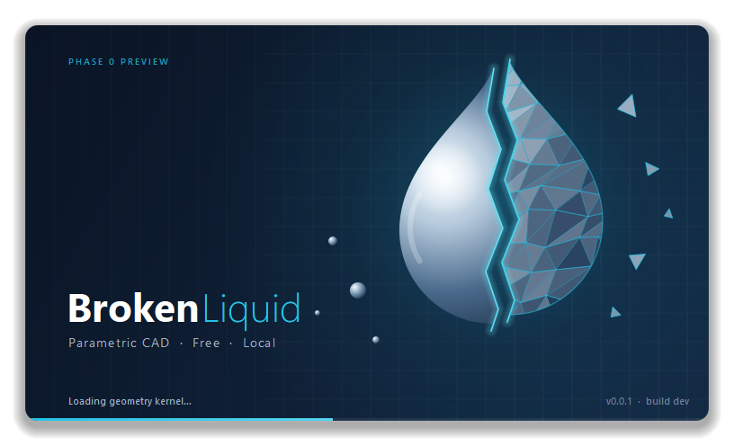
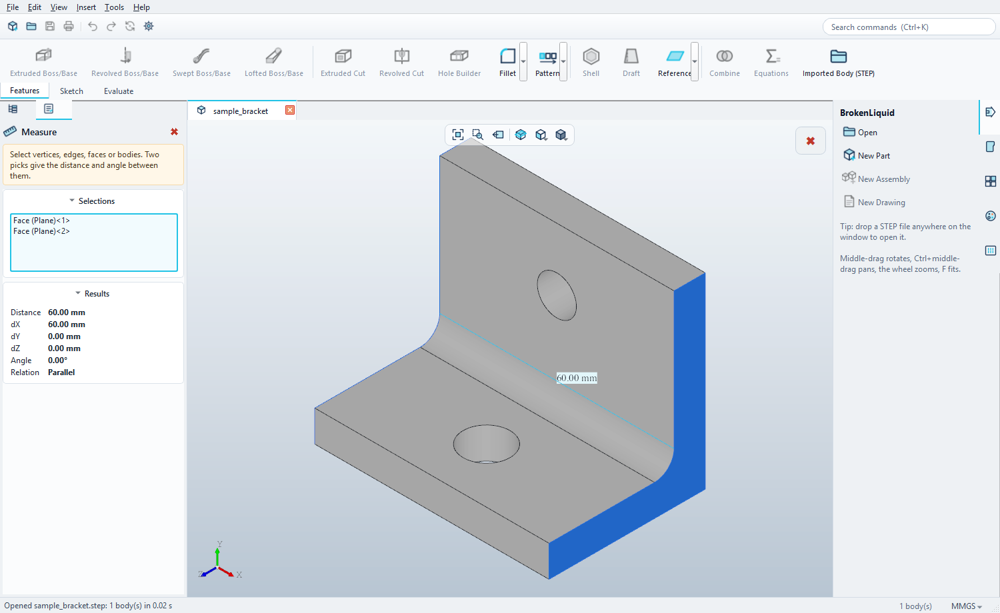
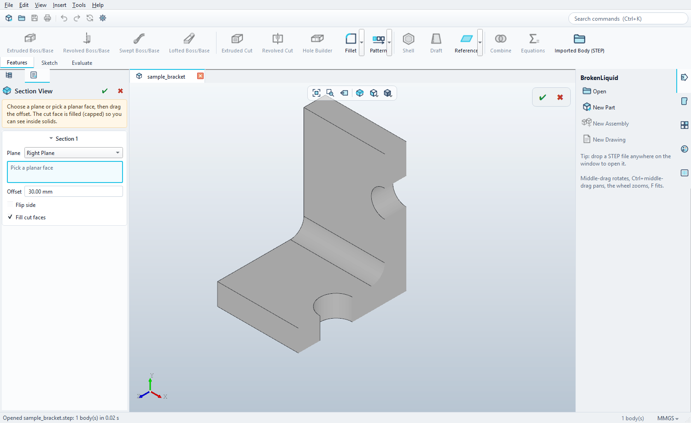

# BrokenLiquid

Free, local, history-based parametric 3D CAD for Windows, with a workflow SolidWorks users will
find familiar: sketch → feature → part → assembly → automatic engineering drawing.

**Status:** Phase 1 (app shell) in progress. You can open STEP files as parts (one tab each),
measure distances, angles, lengths and areas, cut the model with a section view, and rename,
hide, recolour or delete bodies with full undo/redo. The Home screen, Options dialog (system
options and per-document units) and status-bar units switcher are in. Modelling commands are
visible but marked "Coming in Phase N". The Phase 0 spikes (naming, drawing projection, mate
solver) passed; results are in [docs/adr](docs/adr/README.md).








## Documents

- [docs/PLAN.md](docs/PLAN.md) — research, v1.0 scope, technology decision, architecture,
  UI spec, splash screen, packaging, testing and roadmap.
- [docs/FUTURE_FEATURES.md](docs/FUTURE_FEATURES.md) — everything deliberately left out of v1,
  grouped by area with tier and size.
- [docs/adr/](docs/adr/README.md) — architecture decision records, including the Phase 0 spike
  results.

## Stack

C++20 · Qt 6 Widgets · Open CASCADE Technology 8 · Eigen · spdlog · nlohmann/json · GoogleTest ·
CMake + Ninja + vcpkg. Later: embedded Python 3, Inno Setup installer.

## Building on Windows

Needs Visual Studio 2022 (or newer) with *Desktop development with C++*, CMake 3.27+, Git, and a
vcpkg checkout (`VCPKG_ROOT`). The first configure builds Qt and Open CASCADE from source, which
takes one to two hours; later builds reuse the vcpkg binary cache.

```powershell
git clone https://github.com/microsoft/vcpkg.git .toolchain\vcpkg
.toolchain\vcpkg\bootstrap-vcpkg.bat -disableMetrics
$env:VCPKG_ROOT = "$PWD\.toolchain\vcpkg"
./scripts/build.ps1 -Test        # configure + build preset "dev" + run tests and spikes
./scripts/build.ps1 -Run         # build and launch
```

Everything a build needs stays inside the project folder, all git-ignored: `.toolchain/`
(vcpkg, its binary cache, temp files for long builds), `vcpkg_installed/` (built dependencies) and
`build/`. Machine-specific paths go in an untracked `CMakeUserPresets.json` with a preset that
inherits `dev`, plus `scripts/env.local.ps1`; `build.ps1` picks them up automatically.

Useful app switches: `BrokenLiquid.exe part.step`, `--nosplash`, `--new-instance`,
`--smoke-test out.png` (opens the files, renders, saves a window screenshot and exits; needs a
real OpenGL 3.3+ GPU, so it is not run on hosted CI).

## Layout

```
src/core     logging, settings, paths, crash dumps (no Qt)
src/kernel   OCCT services: STEP import/export, shape statistics
src/render   OCCT viewer inside a QOpenGLWidget
src/ui       main window, Command Bar, Feature Tree, Resource Pane, View HUD, themes, icons
src/app      entry point, splash screen, single-instance handling
tests/       GoogleTest unit tests
spikes/      Phase 0 experiments (naming, HLR drawings, mate solver); results in docs/adr/
resources/   icons (generated by scripts/make_icons.py), app icon, themes
```
