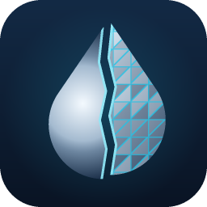
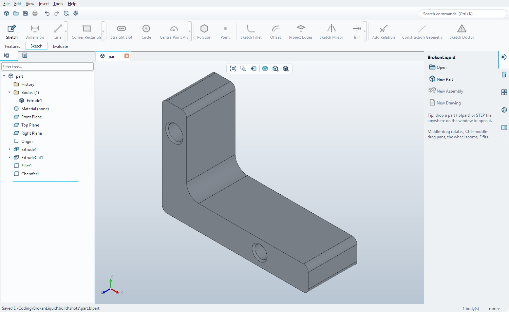
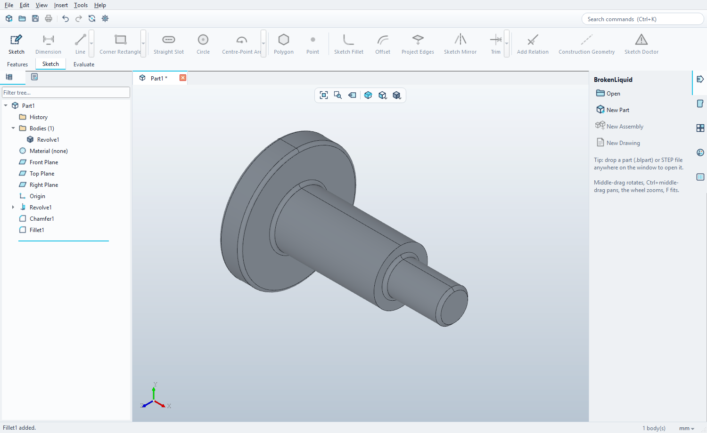
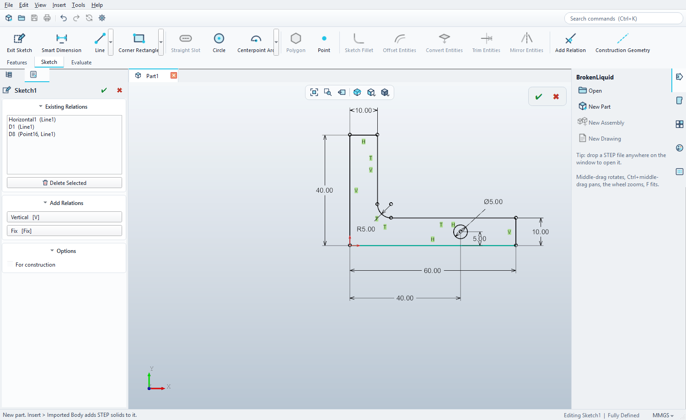
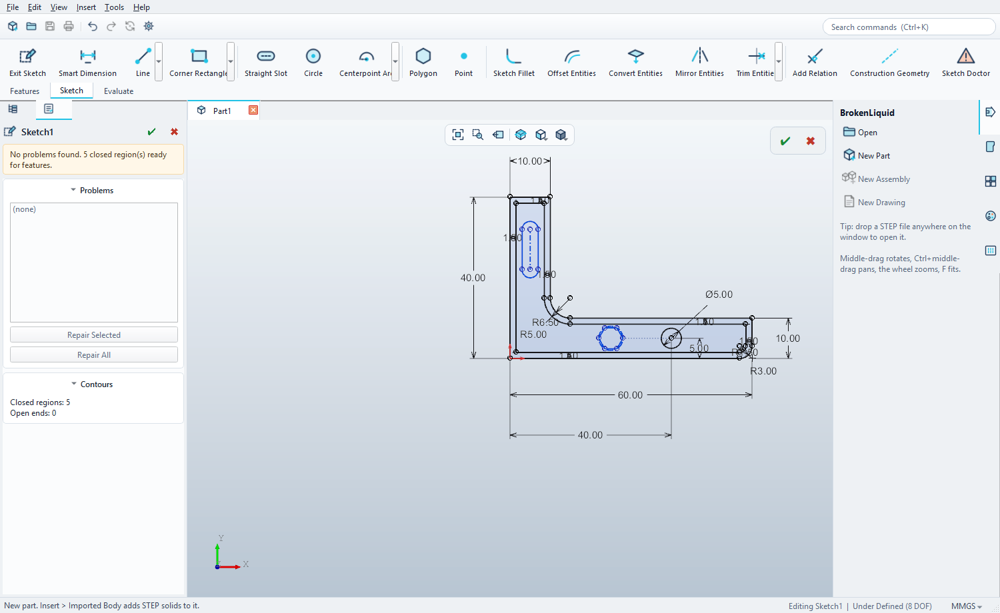
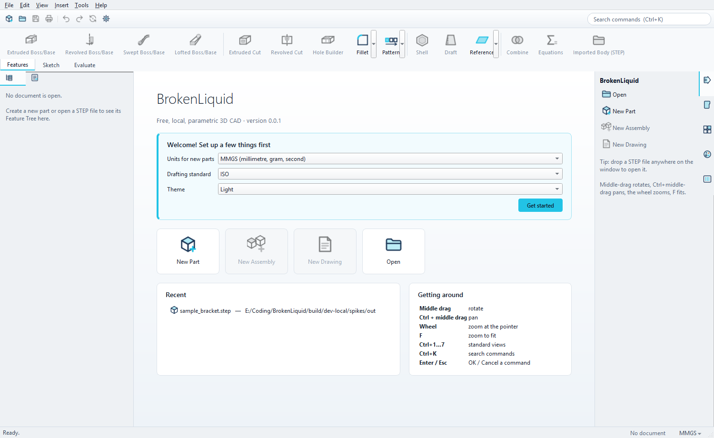

<!--
  Logo: replace docs/images/logo.png with the final artwork (square PNG, 256 px or larger
  looks best). It is currently a copy of the app icon in resources/app/.
-->
<p align="center">
  
</p>

<h1 align="center">BrokenLiquid</h1>

<p align="center">
  <b>Free parametric 3D CAD for Windows.</b><br>
  Sketch, model, assemble and make drawings, all on your own machine.
</p>

<p align="center">
  
  
  
  
</p>

---

## Why BrokenLiquid?

Did you learn 3D CAD at school, at university or at work, and then lose access or get put off by
expensive subscriptions the moment you left? The professional tools cost a lot, many of them now
need an online account just to start, and the free options usually mean learning a completely
different way of working. BrokenLiquid is being made to bring a familiar, intuitive and always free
way to continue 3D modelling without breaking the bank.

**Our Goals:**

- Free-to-use and fully offline — no account, no login, no telemetry
- Keep your files on your own disk, in an open format
- Maintain a familiar feel for anyone who has used a mainstream modeller - no need to learn from
  scratch
- Modular, robust and fast - use what you need

## Plans for V1

**Parts - Assemblies - Drawings - DONE WELL**

| Area | What's planned |
|---|---|
| **Sketching** | 2D sketches on planes and flat faces, relations, dimensions, our own constraint solver with status colours, trim, extend, offset, mirror, and edges copied from the model |
| **Parts** | Extrude, revolve, sweep and loft (adding or cutting material), fillet, chamfer, shell, draft, holes, linear and circular patterns, mirror, reference geometry, combine, move/copy body, equations, materials, mass properties, appearances |
| **Assemblies** | Insert components, standard mates with clear error messages, drag parts within their remaining freedom, interference check, bill of materials |
| **Drawings** | ISO and ANSI sheets, standard, projected, section and detail views, model dimensions, auto-dimensioning, hole callouts, BOM with balloons, one-click Auto Drawing, PDF, DXF and SVG export |
| **Files** | Our own `.blpart`, `.blasm` and `.bldraw` files, STEP and IGES in and out, STL, OBJ and glTF export |
| **Automation** | A Python API (anything you can click, a script can do) and a command line for batch jobs |
| **Install** | Windows 10/11 installer and a portable zip |

Not in v1: sheet metal, weldments, surfacing, configurations, simulation, CAM and rendering.
They're on the list for later (see [After v1](#after-v1)). The full plan is in
[docs/PLAN.md](docs/PLAN.md).

## Where it's at

It's early days, and BrokenLiquid isn't ready for real work yet. We're building it in phases, and
each phase has to run and pass its tests before the next one starts.

| # | Phase | What's in it | Status |
|---|---|---|---|
| 0 | Foundations | Build system, 3D viewer in a Qt window, four technical experiments | Done |
| 1 | App shell | Main window, command bar, feature tree, property panels, home screen, themes, undo/redo, STEP import, measure, section view | Done |
| 2 | Sketcher | Sketch entities, relations, dimensions, the 2D solver, editing tools, regions, Sketch Doctor | Done |
| 3 | Part modelling | Features, rebuilds, stable face and edge names, native files | In progress |
| 4 | Assemblies | Components, mates, interference, BOM | Planned |
| 5 | Drawings | Views, hidden lines, annotations, Auto Drawing, PDF/DXF | Planned |
| 6 | Polish and release | Python console, tutorials, installer, performance, public beta, then v1.0 | Planned |

In phase 3 so far you can extrude and revolve sketches to add or cut material, add fillets and
chamfers, sketch on the faces of a model, and edit, suppress or roll back any feature. Faces and
edges keep their names when you change something earlier in the history, so a fillet stays on
the edge you picked. Parts save as `.blpart` files, and File > Export writes STEP, STL, OBJ
and glTF (`.glb`). Unsaved changes are autosaved every few minutes, and after a crash BrokenLiquid
offers to bring them back.

Still to do in phase 3: sweep, loft, shell, draft, holes, patterns, mirror, reference geometry,
equations, materials, mass properties, and modelling our ten test parts.

### Screenshots

<table>
  <tr>
    <td></td>
    <td></td>
  </tr>
  <tr>
    <td align="center"><sub>Extrude, cut, fillet and chamfer</sub></td>
    <td align="center"><sub>Revolve around a centreline</sub></td>
  </tr>
  <tr>
    <td></td>
    <td></td>
  </tr>
  <tr>
    <td align="center"><sub>A fully defined sketch</sub></td>
    <td align="center"><sub>Sketch tools and the Sketch Doctor</sub></td>
  </tr>
  <tr>
    <td></td>
    <td></td>
  </tr>
  <tr>
    <td align="center"><sub>Section view</sub></td>
    <td align="center"><sub>Measuring</sub></td>
  </tr>
  <tr>
    <td></td>
    <td></td>
  </tr>
  <tr>
    <td align="center"><sub>Home screen</sub></td>
    <td align="center"><sub>Splash screen</sub></td>
  </tr>
</table>

## After v1

We'd rather ship a solid v1 than a half-finished everything, so the bigger ideas wait their turn.
The near-term list lives in [docs/FUTURE_FEATURES.md](docs/FUTURE_FEATURES.md):

- **v1.1:** exploded views, splines, drag handles on features, a radial gesture menu, more mate
  types, a macro recorder
- **v1.2:** configurations and design tables, a full hole tool, a standard parts library
  (fasteners, bearings), GD&T and revision tables
- **v1.3:** sheet metal with flat-pattern DXF for laser cutting, 3MF export and send-to-slicer,
  local version history
- **v2:** surfacing, weldments, editing imported geometry directly, motion studies, a Linux build

Further out, we'd like BrokenLiquid to handle more of the work that happens around a 3D model.
[docs/LONG_TERM.md](docs/LONG_TERM.md) goes into detail, but roughly:

- **Simulation:** stress, vibration and heat checks, and later motion, fatigue and flow, using
  open-source solvers
- **Electrical:** keep a PCB in sync with its enclosure, route cables, and eventually schematics
  and wiring harnesses
- **Routing:** pipes, tubes and ducts with fittings, cut lists and bend tables
- **2D drafting:** a proper 2D workspace with layers, blocks and DXF/DWG
- **Manufacturing:** 3D printing hand-off, inspection drawings, 2.5D CAM, cost estimates
- **Automation:** Python rules, custom features, and calculators that size and model shafts,
  gears and bolts
- **New ways to model:** direct editing, mesh bodies, freeform shapes, scan to part
- **Sharing:** a free viewer, assembly instructions, rendering
- **Versions:** history, branching and merging, without needing a cloud

Whatever gets added has to work offline and fit into the same parts, assemblies and drawings.

## Docs

- [docs/PLAN.md](docs/PLAN.md): the v1 plan (scope, architecture, UI, testing and roadmap)
- [docs/FUTURE_FEATURES.md](docs/FUTURE_FEATURES.md): features saved for after v1
- [docs/LONG_TERM.md](docs/LONG_TERM.md): longer-term ideas and the open-source tools that could
  help
- [docs/adr/](docs/adr/README.md): design decisions and why we made them

## Built with

C++20, Qt 6, [Open CASCADE](https://dev.opencascade.org/) 8, Eigen, spdlog, nlohmann/json and
GoogleTest, built with CMake, Ninja and vcpkg. Python scripting and an installer come later.

## Building on Windows

You'll need Visual Studio 2022 or newer (with the *Desktop development with C++* workload), CMake
3.27+ and Git. The first build compiles Qt and Open CASCADE from source through vcpkg, so expect
it to take an hour or two. After that it's quick.

```powershell
git clone https://github.com/microsoft/vcpkg.git .toolchain\vcpkg
.toolchain\vcpkg\bootstrap-vcpkg.bat -disableMetrics
$env:VCPKG_ROOT = "$PWD\.toolchain\vcpkg"
./scripts/build.ps1 -Test        # build and run the tests
./scripts/build.ps1 -Run         # build and start the app
```

Everything the build needs stays inside the project folder and is git-ignored (`.toolchain/`,
`vcpkg_installed/` and `build/`). If you need machine-specific paths, put them in an untracked
`CMakeUserPresets.json` (with a preset that inherits `dev`) or in `scripts/env.local.ps1`, and
`build.ps1` will pick them up.

A few command-line options are handy: open a file straight away (`BrokenLiquid.exe part.step` or
`part.blpart`), skip the splash with `--nosplash`, force a second window with `--new-instance`, or
take a screenshot and quit with `--smoke-test out.png` (this needs a real GPU with OpenGL 3.3+).

## What's where

```
src/core     logging, settings, paths, units, crash dumps (no Qt)
src/sketch   2D sketch model and constraint solver
src/kernel   geometry: features, face and edge naming, measuring, STEP import, exports
src/doc      part document, rebuilds, .blpart files, autosave
src/render   3D viewer and sketch display
src/ui       main window, command bar, feature tree, property panels, commands, themes, icons
src/app      startup, splash screen, single-instance handling
tests/       unit tests
spikes/      early experiments (results are in docs/adr/)
resources/   icons, app icon, themes
docs/        plans, decisions and images
```

## Contributing

It's a small project at the moment. Bug reports, ideas and feedback are very welcome in the
issues. We'll open up to code contributions once there are some contribution guidelines.

## Licence

MIT, see [LICENSE](LICENSE). Qt and Open CASCADE are LGPL and are linked dynamically.
